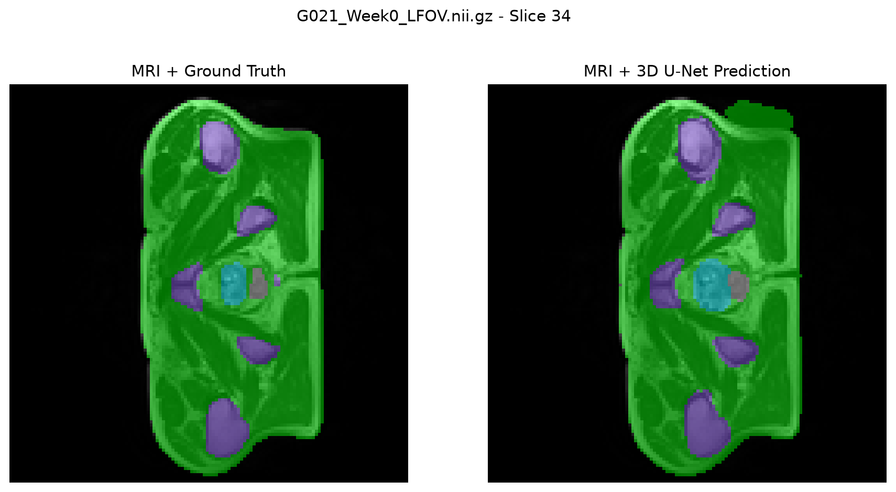
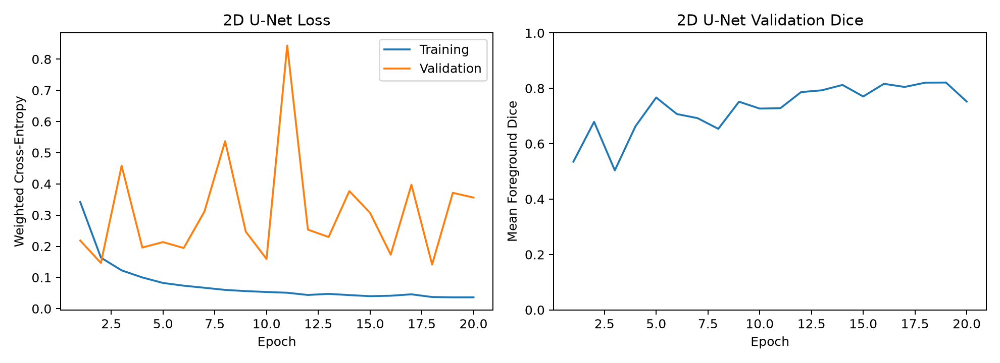
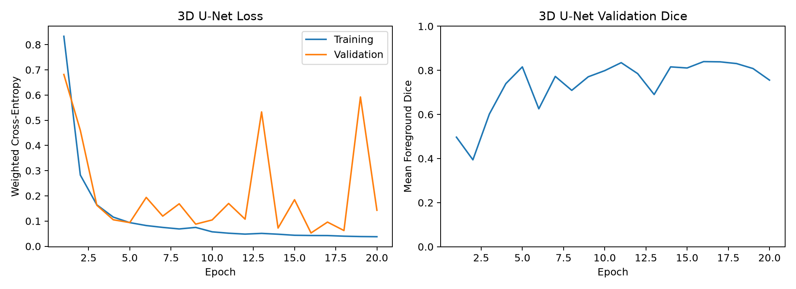
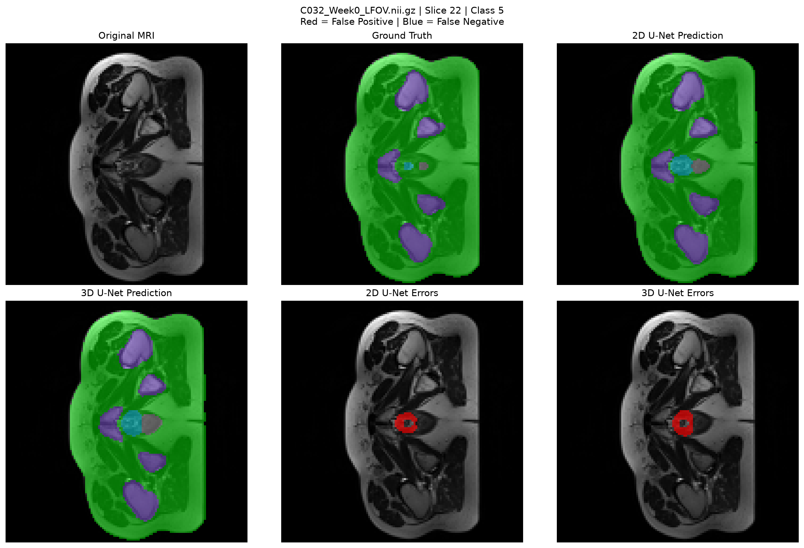
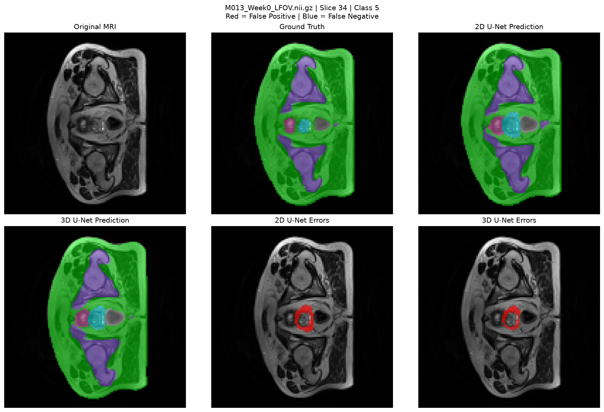
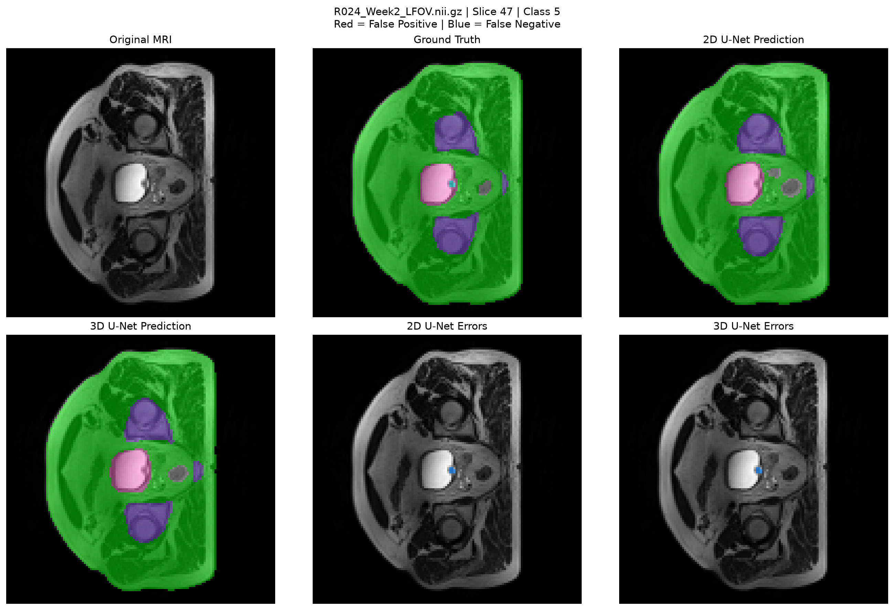
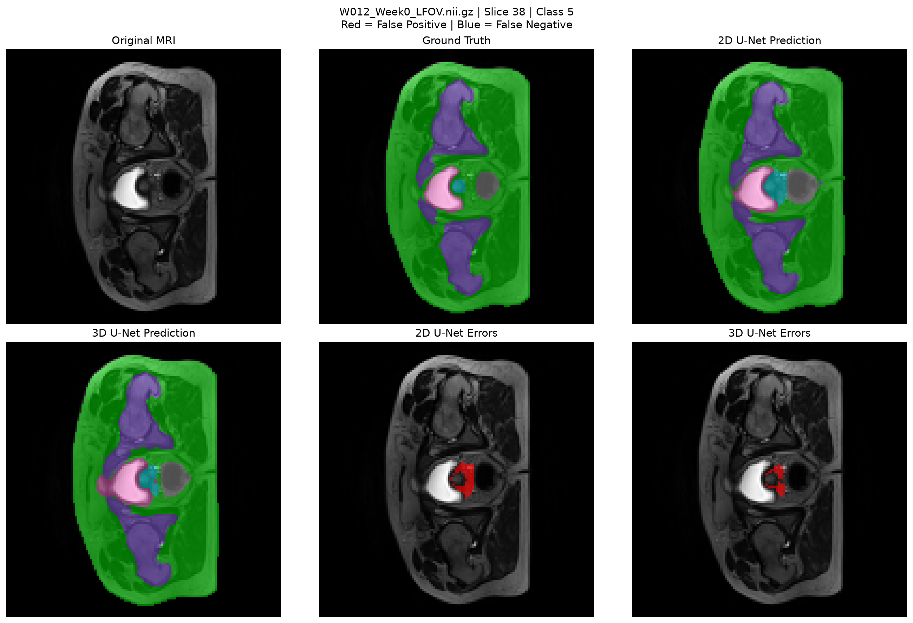

# HipMRI Segmentation Using a 3D U-Net
## 1.0 Project Overview
Accurate anatomical segmentation of MRI Volumes is important in prostate radiotherapy planning, where the prostate and surrounding organs must be identified to support treatment planning. Incorrect segmentation boundaries may lead to uneccessary irradiation of healthy tissue or insufficient coverage of the intended treatment region.

This project investigates whether incorporating 3D spatial information improves segmentation performance compared with a conventional 2D U-Net. Although 2D models process MRI slices independently, 3D models can learn features across neighbouring slices, potentially improving anatomical consistency and boundary accuracy. However, 3D processing also introduces greater computational requirements, particularly GPU memory usage.

The objective is to determine whether these additional computational costs are justified by measurable improvements in segmentation accuracy and clinically important boundary errors.

Both models were implemented using PyTorch and evaluated on the HipMRI dataset using identical held-out test patients. Performance was assessed through per-class Dice Similarity Coefficient (DSC), Intersection over Union (IoU), inference time, GPU memory consumption and qualitative boundary-error analysis.

The intended application is an anatomical contouring assistant in which predictions would be reviewed by a specialist rather than used for autonomous clinical decision-making.
## 2.0 Model Architecture and Working Principles
### 2.1 U-Net Architecture
The U-Net is a convolutional neural network designed for image segmentation, originally proposed by Ronneberger et al. (2015). It uses an encoder–decoder architecture with skip connections to combine high-level features with spatial information from earlier layers.

The encoder progressively reduces the spatial dimensions of the input while increasing the number of feature channels. This allows the model to learn more complex features. The decoder then restores the original spatial resolution through upsampling.

Skip connections transfer feature maps from the encoder directly to the corresponding decoder layers. These help recover spatial details that may otherwise be lost during downsampling, which is particularly important for identifying anatomical boundaries.
### 2.2 2D U-Net Baseline
A conventional 2D U-Net was implemented as the baseline model. It processes individual MRI slices of size 128 × 128 pixels and predicts a segmentation label for each pixel.
The 2D U-Net baseline builds upon the encoder-decoder architecture and training concepts explored in my previous COMP3710 Demo 2 implementation. The baseline was subsequently adapted to the HipMRI dataset, with patient-level data splitting, class-weighted loss and preprocessing aligned with the 3D U-Net to support a fair comparison.

The encoder consists of four downsampling stages with 32, 64, 128 and 256 feature channels, followed by a bottleneck containing 512 channels.

Each convolution block contains two 3 × 3 convolution layers, followed by batch normalisation and ReLU activation functions. Max-pooling reduces the spatial dimensions, while transposed convolutions restore the resolution during decoding.

The final 1 × 1 convolution produces six output channels corresponding to the dataset's segmentation labels.

Although the 2D U-Net can identify anatomical structures within each slice, it does not directly use information from adjacent slices. This may limit its ability to maintain consistent segmentation boundaries throughout a 3D volume.
### 2.3 3D U-Net 
The proposed model is a 3D U-Net based on the architecture introduced by Çiçek et al. (2016).

The main difference from the 2D baseline is the use of 3D convolution, pooling and upsampling operations. Instead of processing individual slices, the 3D U-Net processes complete resized MRI volumes with dimensions of 64 × 128 × 128 voxels.

Each convolution block uses two 3 × 3 × 3 convolution layers, allowing features to be learned across depth, height and width. This enables the network to incorporate information from neighbouring slices when predicting anatomical structures.

The encoder uses four downsampling stages with 16, 32, 64 and 128 feature channels, followed by a 256-channel bottleneck. The decoder uses transposed convolutions and skip connections to recover the original spatial dimensions.

The final 1 × 1 × 1 convolution produces six output channels, representing the predicted class scores for every voxel.

The smaller feature-channel sizes compared with the 2D model were selected to reduce the memory requirements of volumetric processing.
### 2.4 Comparison of Model Architectures
| Feature | 2D U-Net | 3D U-Net |
| - | - | - |
| Input | 2D MRI slice | 3D MRI volume |
| Input dimensions | 128 x 128 | 64 x 128 x 128 |
| Convolution kernels | 3 x 3 | 3 x 3 x 3 |
| Downsampling stages | 4 | 4 |
| Bottleneck channels | 512 | 256 |
| Skip connections | Yes | Yes |
| Output classes | 6 | 6 |
| Neighbouring-slice context | Not directly used | Included |

*Table 1. Architectural comparison of the 2D and 3D U-Net models.*

The central investigation is whether the 3D U-Net's additional spatial context produces meaningful improvements in segmentation boundaries compared with the 2D baseline, and whether these improvements justify its computational costs.
### 2.5 Example Segmentation Output
The following figure shows a validation MRI slice with the ground-truth segmentation and the corresponding 3D U-Net prediction overlaid on the original MRI.



*Figure 1. Comparison of ground-truth segmentation and 3D U-Net prediction on a validation MRI slice. Coloured regions represent the predicted anatomical labels.*

This visualisation demonstrates the output produced by the trained network. A more detailed comparison of the 2D and 3D predictions, including false-positive and false-negative regions, is presented in the boundary-error analysis section.
## 3.0 Feasibility Review
### 3.1 User Need, Scope and Acceptance Criteria
Accurate segmentation of prostate MRI volumes is important in radiotherapy planning, where anatomical structures must be delineated reliably while minimising errors near clinically important boundaries.

The purpose of this prototype is to investigate whether incorporating volumetric spatial information using a 3D U-Net provides more consistent prostate segmentation than a conventional 2D U-Net baseline, particularly at difficult anatomical boundaries and across adjacent MRI slices.

The core investigation is whether 3D volumetric context reduces clinically important boundary and slice-transition errors compared with a standard 2D baseline, and whether any improvement justifies the additional GPU memory and training time required.

The following acceptance criteria will be used:

1. The final 3D U-Net will target a Dice score of at least 0.70 on the HipMRI test dataset.
2. Patient-level separation will be enforced across training, validation and testing sets. All MRI volumes belonging to the same patient will be assigned to only one subset to prevent data leakage.
3. The 2D U-Net baseline and 3D U-Net will be evaluated on the same held-out test patients using the Dice Similarity Coefficient (DSC) and Intersection over Union (IoU).
4. Representative segmentation failures will be investigated, with particular attention to difficult anatomical boundaries and slice-transition errors.
5. Peak GPU memory usage and per-case inference time will be measured to assess whether improvements from 3D processing justify the additional computational cost.
### 3.2 Model Choice and Course Concepts
A standard 2D U-Net will be used as the baseline model, while the proposed final model is a 3D U-Net adapted to the HipMRI volumetric dataset.

A previously developed 2D U-Net from DEMO 2 will be adapted for the baseline. Reusable components include the encoder-decoder structure, skip connections, training and validation framework, dice-based evaluation and segmentation visualisation. The hipMRI data-loading pipeline, patient level splitting and volumetric 3D U-Net implementation will be developed specifically for this project.

The final architecture will be based on the 3D U-Net approach of the paper given. The 3D U-Net extends the U-Net concept to volumetric data, allowing convolutional features to be learned across the depth dimension as well as the two in plane spatial dimensions. The architecture therefore uses volumetric convolutions and skip connections to recover spatial detail while incorporating context from neighbouring MRI slices.

There is no lecture content for 3D U-Nets, only 2D ones. Thus the paper will be the main source of architectural details
### 3.3 Preliminary Feasibility Evidence
An initial audit was successfully completed using the paired HipMRI volume: M030_Week1_LFOV.nii.gz and M030_Week1_SEMANTIC.nii.gz

Both the MRI and segmentation had dimensions of: 256 × 256 × 128 voxels

and matching voxel spacing of approximately: 1.680 × 1.680 × 1.560 mm The MRI and segmentation had both matching spatial dimensions and matching affine matrices, indicating correct spatial alignment for the inspected case.

Z-score intensity normalisation was successfully applied to the MRI and produced:

Mean = 0.0000

Standard deviation = 1.0000

Six segmentation values were observed, labelled 0–5. Their distributions were:
| Label | Percentage of Voxels (%) |
| - | - |
| 0 | 61.072 |
| 1 | 35.112 |
| 2 | 2.885 |
| 3 | 0.758 |
| 4 | 0.102 |
| 5 | 0.070 |

*Table 2. Voxel distribution across segmentation labels in the preliminary HipMRI feasibility sample.*

Label 0 will be included for testing, but since it is just the background, it will be excluded from reported foreground averages.
This demonstrates substantial class imbalance, with the two smallest labelled regions occupying only approximately 0.10% and 0.07% of the volume. This reinforces the requirement for class-specific Dice and IoU rather than overall voxel accuracy.

The HipMRI dataset contains annotations for the body outline (Class 1), bone (Class 2), bladder (Class 3), rectum (Class 4) and prostate (Class 5).

The successful loading, normalisation and spatial-alignment test indicates that the dataset can be processed successfully for the proposed 3D segmentation pipeline.

### 3.4 Risks, Computing Budget and Fallback
The primary technical risk is GPU memory usage, as full 256 × 256 × 128 volumes processed using 3D convolutions require substantially more memory than 2D slices. Additional risks include severe class imbalance, loss of small anatomical structures during downsampling, inconsistent label encoding across cases, and patient-level data leakage.

Training and GPU testing will be performed on the Rangpur comp3710 GPU partition using a single A100 GPU. Initial experiments will use short smoke tests and a batch size of 1 before longer training jobs are submitted. Peak VRAM will be measured during these tests.

The next experiment will audit multiple HipMRI cases to confirm label consistency and patient identifiers, implement the patient-level split, and then perform a single 3D U-Net forward-pass smoke test. Where the smoke test is just loading and testing a small test point to make sure that the model works.

If full-volume training exceeds the available GPU memory, the fallback will be to reduce the input volume dimensions or use 3D subvolumes/patches with a small batch size while retaining the required 3D U-Net architecture. Mixed-precision training may also be used if required. The 2D U-Net will remain the comparison baseline rather than replacing the final 3D model.
## 4.0 Dataset and Experimental Methodology
### 4.1 HipMRI Dataset
The HipMRI dataset contains 3D MRI volumes and their corresponding anatomical segmentation masks in NIfTI format (.nii.gz). Each volume is paired with its segmentation using the patient identifier and imaging week.

The dataset contains 211 MRI volumes from 38 patients. The HipMRI segmentation masks contain six numerical labels, representing the background and five anatomical structures. These structures include the body outline, bone, bladder, rectum and prostate.

| Label (Class) | Anatomical structure |
| - | - |
| 0 | Background |
| 1 | Body Outline |
| 2 | Bone |
| 3 | Bladder |
| 4 | Rectum |
| 5 | Prostate |

*Table 3. Anatomical structures represented by the HipMRI segmentation labels.*

### 4.2 Patient Level Data Splitting
The dataset was divided into training, validation and testing sets at the patient level to prevent data leakage. All MRI volumes belonging to the same patient were assigned to a single subset.

A fixed random seed of 67 was used to make the split reproducible.
| Dataset | Patients | MRI Volume |
| - | - | - |
| Training | 26 | 140 |
| Validation | 6 | 37 |
| Testing | 6 | 34 |
| Total | 38 | 211 |

*Table 4. Patient-level training, validation and testing split.*

Both the 2D and 3D U-Net models used the same patient split to ensure a fair comparison.
### 4.3 Data Preprocessing
Each MRI volume underwent Z-score intensity normalisation to standardise its intensity distribution.

The original MRI and segmentation dimensions were 256 × 256 × 128 voxels. These were resized to 64 × 128 × 128 in depth, height and width order to reduce computational requirements.

Trilinear interpolation was applied to MRI intensities, while nearest-neighbour interpolation was used for segmentation masks to preserve integer class labels.

The masks were also converted into six-channel one-hot representations. Integer class labels were retained for cross-entropy loss calculation.

For the 2D baseline, the same preprocessed volumes were divided into individual slices. This ensured that both networks received consistently prepared data.
### 4.4 Training Configuration
Both models were implemented using PyTorch and trained on the Rangpur computing cluster.

| Parameter | 2D U-Net | 3D U-Net |
| - | - | - |
| Optimiser | Adam | Adam |
| Learning rate | 0.001 | 0.001 |
| Epochs | 20 | 20 |
| Training batch size | 8 slices | 1 volume |
| Loss function | Weighted cross-entropy | Weighted cross-entropy |
| Output classes | 6 | 6 |
| Model selection | Lowest validation loss | Lowest validation loss|

*Table 5. Training configurations used for the 2D and 3D U-Net models.*

Class weighting was used to address the substantial imbalance between anatomical labels. Weights were calculated from training-set voxel counts, giving less frequent classes greater importance during optimisation.

The checkpoint with the lowest validation loss was saved for subsequent evaluation.
### 4.5 Evaluation Metrics
Segmentation performance was assessed using the Dice Similarity Coefficient (DSC) and Intersection over Union (IoU).

**Dice Similarity Coefficient (DSC):**

$$
DSC = \frac{2TP}{2TP + FP + FN}
$$

**Intersection over Union (IoU):**

$$
IoU = \frac{TP}{TP + FP + FN}
$$

Here, TP, FP and FN represent true-positive, false-positive and false-negative voxels for a given class.

The reported mean Dice and IoU scores were calculated by averaging the five foreground class scores, with background label 0 excluded. Class-specific results were aggregated across the held-out test volumes.

## 5.0 Results and Quantitative Comparison
### 5.1 Training and Validation Curves
Both U-Net models were trained for 20 epochs using weighted cross-entropy loss. Training and validation losses were monitored to assess convergence, alongside foreground validation Dice scores.

**2D U-Net Training**



*Figure 2. Training and validation performance of the patient aligned 2D U-Net.*

**3D U-Net Training**



*Figure 3. Training and validation performance of the 3D U-Net.*

Both models showed decreasing training loss over the 20 epochs, indicating that they were learning from the training data. However, validation loss fluctuated considerably, particularly during later epochs. This suggests that improvements in training performance did not consistently translate to better generalisation. For this reason, the checkpoint with the lowest validation loss was retained rather than automatically selecting the final epoch.
### 5.2 Test Set Segmentation Performance
Both models were evaluated using the same six held-out patients, containing 34 MRI volumes. Dice and IoU were calculated for foreground classes 1–5, excluding the background.

| Class | 2D Dice | 3D Dice | 2D IoU | 3D IoU |
| - | - | - |- | - |
| 1 | 0.9752 | 0.9822 | 0.9516 | 0.9649 |
| 2 | 0.8979 | 0.8939 | 0.8147 | 0.8082 |
| 3 | 0.9207 | 0.9235 | 0.8531 | 0.8578 |
| 4 | 0.7340 | 0.7305 | 0.5798 | 0.5754 |
| 5 | 0.6743 | 0.6804 | 0.5086 | 0.5156 |
| **Mean** | **0.8404** | **0.8421** | **0.7416** | **0.7444** |

*Table 6. Per-class Dice and IoU results on the held-out test set.*

The 3D U-Net achieved a mean foreground Dice score above 0.70. However, the prostate (class 5) achieved a Dice score of 0.6804, below the 0.70 target. The 2D baseline achieved a prostate Dice score of 0.6743, indicating that incorporating 3D spatial context provided only a small improvement for the primary anatomical structure of interest.

Although the 3D U-Net exceeded the specified Dice target of 0.70 when averaged across foreground classes, the prostate (class 5) achieved a Dice score of only 0.6804, falling below this threshold. The 2D baseline achieved a prostate Dice score of 0.6743, indicating that the 3D model provided only a small improvement in prostate segmentation.

These findings highlight the difficulty of accurately segmenting smaller anatomical structures and demonstrate why per-class performance should be considered alongside overall segmentation accuracy. Additional volumetric context did not fully overcome the effects of class imbalance or the potential loss of anatomical detail caused by downsampling.
### 5.3 Computational Resource Comparison
GPU memory consumption and inference time were recorded during evaluation to compare the computational requirements of both models.

| Metric | 2D U-Net | 3D U-Net |
|---|---:|---:|
| Model parameters | 7,765,574 | 5,647,942 |
| Mean Dice | 0.8404 | 0.8421 |
| Mean IoU | 0.7416 | 0.7444 |
| Peak evaluation GPU memory | 0.169 GiB | 0.543 GiB |
| Average inference time per slice | 0.000505 s | — |
| Approximate inference time per volume | 0.0323 s | 0.0177 s |

*Table 7. Computational resource comparison of the 2D and 3D U-Net models during evaluation. The 2D per-volume time is estimated by multiplying the average per-slice time by 64.*

The 3D U-Net contains fewer trainable parameters (5,647,942) than the 2D baseline (7,765,574), despite requiring approximately 3.2 times more GPU memory during evaluation.

Peak GPU memory was measured using `torch.cuda.max_memory_allocated()`, which records the maximum memory allocated by PyTorch tensors rather than total GPU VRAM usage. The higher memory requirement of the 3D model arises from processing volumetric feature maps and storing their intermediate activations. Therefore, parameter count alone does not determine the memory requirements of a neural network.

However, the 3D U-Net's measured forward-pass time per volume was lower than the estimated time required for the 2D model to process all 64 slices. These measurements describe model inference rather than the complete preprocessing and prediction pipeline. Differences in inference batch sizes also limit direct timing comparisons.

Overall, the marginal improvement in segmentation accuracy must be considered alongside the higher GPU memory requirements of the 3D model.
## 6. Boundary-Error Analysis
Although the 3D U-Net achieved a slightly higher mean Dice score, aggregate performance metrics do not fully describe the segmentation errors produced by each model.

Four held-out test cases were selected for qualitative analysis, focusing on prostate segmentation (class 5). The figures compare the 2D and 3D predictions against the ground truth, highlighting false-positive and false-negative regions.

Red regions indicate false-positive predictions, while blue regions indicate false negatives.
### 6.1 C032 — First Labelled Slice



*Figure 4. Boundary-error comparison for C032, Week 0, class 5, slice 22.*

At the first slice containing the prostate annotation, both models predict a larger region than the ground truth, resulting in false-positive errors around the small annotated structure.

The 3D U-Net produces a slightly larger false-positive region than the 2D baseline. This suggests that incorporating information from neighbouring slices does not necessarily improve boundary accuracy, particularly where the prostate first appears in the volume.

This case demonstrates that 3D spatial context can also contribute to over-segmentation rather than consistently improving accuracy.
### 6.2 M013 — Maximum-Error Slice



*Figure 5. Boundary-error comparison for M013, Week 0, class 5, slice 34.*

Both models overestimate the size of the prostate, producing a substantial ring of false-positive predictions around the annotated region.

The 3D U-Net appears to produce a slightly narrower false-positive region than the 2D baseline, although the difference is relatively small. Both networks identify the approximate location of the prostate but struggle to reproduce its correct boundary.

This suggests that the main difficulty is distinguishing the prostate from surrounding tissue rather than simply locating it within the MRI.
### 6.3 R024 — Last Labelled Slice



*Figure 6. Boundary-error comparison for R024, Week 2, class 5, slice 47.*

Unlike the previous examples, both models show a small false-negative region, indicating that part of the annotated prostate was not detected.

The errors are localised near the prostate boundary and appear similar between the two models. Neither network demonstrates a clear improvement in this case.

This highlights the difficulty of detecting small prostate regions near the last slice in which they are annotated. The 3D U-Net's neighbouring-slice information does not completely eliminate under-segmentation.
### 6.4 W012 — Last Labelled Slice



*Figure 7. Boundary-error comparison for W012, Week 0, class 5, slice 38.*

The 2D U-Net produces a relatively large false-positive region adjacent to the ground-truth prostate, indicating substantial over-segmentation.

In comparison, the 3D U-Net produces a noticeably smaller false-positive region and follows the annotated prostate boundary more closely.

This is the clearest example among the four selected cases where the 3D model improves prostate segmentation. The result is consistent with the possibility that neighbouring-slice information helps constrain the predicted boundary near the end of an annotated structure.
### 6.5 Summary of Failure Modes
The qualitative results demonstrate that both networks experience difficulty with prostate segmentation, particularly near the first and last slices containing the prostate annotation.

Over-segmentation is the dominant error in C032, M013 and W012, while R024 demonstrates localised under-segmentation.

The 3D U-Net reduces false-positive errors in W012 and provides a smaller improvement in M013. However, it produces a larger false-positive region in C032 and shows little difference from the 2D baseline in R024.

These observations are consistent with the quantitative results, where the 3D model achieved only a marginal improvement in prostate Dice score, from 0.6743 to 0.6804. Although 3D spatial context can improve individual prostate boundaries, the benefit is not consistent across the selected examples.

The four images provide evidence of local boundary behaviour but do not establish whether the 3D model produces more consistent prostate segmentations throughout entire MRI volumes. Evaluating inter-slice continuity would require further analysis across consecutive slices.
## 7. Discussion and Engineering Recommendation
### 7.1 Segmentation Performance
The 3D U-Net achieved a mean Dice score of 0.8421 compared with 0.8404 for the 2D baseline, representing an absolute improvement of 0.0017. Mean IoU also increased slightly from 0.7416 to 0.7444.

Although the 3D model performed better overall, the improvement was marginal and inconsistent across anatomical classes. The 3D U-Net achieved higher Dice scores for classes 1, 3 and 5, whereas the 2D baseline performed better on classes 2 and 4.

The boundary-error analysis supports these findings. The 3D model showed clearer improvements in W012 and a smaller apparent improvement in M013, but produced a larger false-positive region in C032. Both models performed similarly in R024.

These results suggest that incorporating neighbouring-slice information can improve individual segmentation boundaries, but does not guarantee better performance across all cases.
### 7.2 Computational Trade-offs
The 3D U-Net required 0.543 GiB of GPU memory during evaluation, compared with 0.169 GiB for the 2D baseline. This represents approximately 3.2 times greater GPU memory usage.

However, the measured 3D forward-pass time was 0.0177 seconds per volume, compared with an estimated 0.0323 seconds for processing 64 slices using the 2D model.

This indicates that volumetric inference can be computationally efficient when sufficient GPU memory is available. However, these measurements exclude preprocessing and other pipeline operations, and the models used different inference batch sizes.

The higher memory requirement of the 3D model must therefore be weighed against its marginal improvement in segmentation accuracy. Evaluation memory consumption also does not represent the full memory requirements of model training.
### 7.3 Limitations and Future Work
Several limitations should be considered when interpreting the results.

First, the dataset contained only 38 patients, with six reserved for testing. This limits the ability to assess how well the models generalise to a larger and more diverse patient population.

Second, the original MRI volumes were downsampled to 64 × 128 × 128 voxels. Although this reduced computational requirements, it may have removed fine anatomical details, particularly for smaller structures such as the prostate.

Third, both models struggled with prostate segmentation (class 5). The 2D U-Net achieved a Dice score of 0.6743, while the 3D U-Net achieved 0.6804. Both prostate-specific results were below 0.70, indicating that segmentation of this structure remains challenging despite the use of class-weighted loss.

Additionally, although both models were trained for 20 epochs, they used different batch sizes and numbers of optimisation steps per epoch. Therefore, the comparison used identical patient splits and preprocessing but did not represent an identical computational training budget.

A fixed random seed of 67 was used for patient-level data splitting. However, the 3D training implementation did not explicitly fix all random seeds or enforce deterministic GPU operations. Consequently, repeating the training process may produce different model weights and evaluation results.

Finally, the qualitative analysis focused on four selected slices. While these examples revealed local boundary errors, they did not establish whether the 3D model produced more consistent segmentations across consecutive slices.

Future work could investigate higher-resolution inputs, alternative loss functions such as Dice-based losses, and additional boundary metrics, including Hausdorff distance and surface Dice. Evaluating segmentation continuity across entire volumes and testing on additional patients would also help determine whether the 3D architecture provides a meaningful advantage.
### 7.4 Engineering Recommendation
Based on the experimental results, the 2D U-Net is recommended for the current prototype when GPU memory is limited. It achieved nearly identical segmentation accuracy to the 3D U-Net while requiring substantially less GPU memory during evaluation.

Although the 3D U-Net demonstrated improvements in some prostate boundary cases, its overall prostate Dice score increased only from 0.6743 to 0.6804 and remained below the target of 0.70. The additional spatial context therefore did not provide a sufficiently consistent improvement to justify the higher memory requirements for this application.

The 3D U-Net should remain a candidate for further development, particularly if higher-resolution inputs and improved loss functions can increase prostate segmentation accuracy. Neither model should be used for autonomous clinical decision-making without further validation and specialist review.
## 8. Reproducibility and Usage Instructions
### 8.1 Dependencies

The project was implemented using Python and PyTorch, with training and evaluation performed on the Rangpur computing cluster.

The main dependencies used were:

| Library | Version | Purpose |
|---|---|---|
| Python | 3.11.15 | Programming language |
| Conda | 26.5.3 | Environment management |
| PyTorch | 2.13.0 | Model implementation, training and inference |
| NumPy | 2.4.6 | MRI data processing |
| NiBabel | 5.4.2 | Loading NIfTI MRI volumes |
| Matplotlib | 3.11.1 | Visualisation and training curves |
| tqdm | 4.70.1 | Training progress monitoring |

*Table 8. Main software dependencies and their purposes.*

The Python environment used on Rangpur is named `torch`.

### 8.2 Project Structure

The project is located in `recognition/3D_UNet_48009005/` within the PatternAnalysis-2026 GitHub repository.

The committed project files are organised as follows:

```text
3D_UNet_48009005/
├── README.md
├── dataset.py
├── metrics.py
├── modules.py
├── predict.py
├── train.py
├── test_metrics.py
├── smoke_test_2D.py
├── smoke_test_3D.py
├── smoke_test_2D.sh
├── train_smoke_test_2d.sh
├── train_smoke_test_3d.sh
├── train_2d.sh
├── train_2d_aligned.sh
├── train_3d.sh
├── predict_2d.sh
├── evaluate_3d.sh
├── visualise_errors.sh
├── plot_3d_training.sh
└── outputs/
    ├── 2d_aligned_training_curves.png
    ├── 3d_training_curves.png
    ├── 3d_validation_overlay.png
    ├── 3d_validation_prediction.png
    ├── errors_C032_Week0_class5_slice22.png
    ├── errors_M013_Week0_class5_slice34.png
    ├── errors_R024_Week2_class5_slice47.png
    └── errors_W012_Week0_class5_slice38.png
```

The main Python files have the following purposes:

- `dataset.py`: Loads and preprocesses MRI volumes, matches segmentation masks and performs patient-level splitting.
- `modules.py`: Defines the 2D and 3D U-Net architectures.
- `metrics.py`: Calculates per-class Dice and IoU.
- `train.py`: Implements model training, validation and training-curve visualisation.
- `predict.py`: Evaluates trained models and generates segmentation and boundary-error comparisons.
- `test_metrics.py`: Tests the Dice and IoU calculations.
- `smoke_test_2D.py` and `smoke_test_3D.py`: Check that the models can perform forward passes on HipMRI data.

The repository also contains SLURM scripts used during initial development, smoke testing and final experimentation. The reported 2D and 3D training results were produced using `train_2d_aligned.sh` and `train_3d.sh`, respectively.

The dataset, trained model checkpoints and original SLURM output logs are not included in the GitHub repository.

### 8.3 Dataset Setup

The HipMRI dataset must be obtained separately and placed inside the project's local `data/` directory.

The final 2D and 3D experiments require the following structure:

```text
3D_UNet_48009005/
└── data/
    ├── semantic_MRs/
    └── semantic_labels_only/
```

MRI volumes are stored in `data/semantic_MRs/`, while their corresponding segmentation masks are stored in `data/semantic_labels_only/`.

For example:

```text
semantic_MRs/M030_Week1_LFOV.nii.gz
semantic_labels_only/M030_Week1_SEMANTIC.nii.gz
```

Files are matched using their patient identifier and imaging week. The code uses a fixed random seed of 67 to reproduce the same patient-level training, validation and testing split.

The repository also includes an earlier 2D smoke test that uses the separate `keras_slices_data` dataset. However, the final aligned 2D baseline uses the same preprocessed 3D volumes and patient split as the 3D U-Net.

### 8.4 Training Instructions

Training was performed using SLURM jobs on the Rangpur computing cluster.

From the `3D_UNet_48009005` project directory, the Python environment can be activated using:

```bash
source "$HOME/miniconda3/bin/activate"
conda activate torch
```

**Train the aligned 2D U-Net:**

```bash
sbatch train_2d_aligned.sh 20
```

This trains the 2D U-Net for 20 epochs using batches of eight slices. The best checkpoint is saved as:

```text
best_2d_unet_aligned.pth
```

The training function also generates the 2D training curves in `outputs/2d_aligned_training_curves.png`.

**Train the 3D U-Net:**

```bash
sbatch train_3d.sh
```

This trains the 3D U-Net for 20 epochs using a batch size of one volume. The best checkpoint is saved as:

```text
best_3d_unet_weighted.pth
```

Both models use Adam optimisation with a learning rate of 0.001 and weighted cross-entropy loss. The checkpoint with the lowest validation loss is retained for evaluation.

The trained checkpoints are saved locally and are not included in the GitHub repository.

### 8.5 Evaluation and Visualisation

Once training is complete, both models can be evaluated using the held-out test dataset. The corresponding trained model checkpoints must be available in the project directory.

**Evaluate the 2D U-Net:**

```bash
sbatch predict_2d.sh
```

**Evaluate the 3D U-Net:**

```bash
sbatch evaluate_3d.sh
```

The evaluation scripts report per-class Dice and IoU scores, inference time and peak GPU memory allocated by PyTorch.

**Generate boundary-error comparisons:**

```bash
sbatch visualise_errors.sh
```

This script generates comparisons between the 2D and 3D predictions for selected held-out test cases, including false-positive and false-negative regions. The resulting figures are saved in the `outputs/` directory.

**Generate the 3D training curves:**

```bash
sbatch plot_3d_training.sh
```

The 3D training curves were generated from the original SLURM training log, `3D_TRAIN_707312.out`, using the `plot_3d_training()` function. This log is not included in the GitHub repository, although the resulting figure is provided in `outputs/3d_training_curves.png`.

To regenerate the graph, the original training log or a log from a new training run is required. The filename supplied to the plotting function must match the available SLURM output log.

Although the patient-level split is reproducible using the fixed random seed, the training implementation does not enforce fully deterministic GPU operations. Therefore, subsequent training runs may produce slightly different model weights and evaluation results.
## 9. Artificial Intelligence Usage Disclosure

OpenAI ChatGPT (GPT-6) was used as an assistance tool throughout the development and documentation of this project.

AI assistance was used for the following tasks:

- **Code development:** Assisting with the explanation of the 2D and 3D U-Net architectures, dataset preprocessing, training functions and evaluation procedures.
- **Debugging:** Identifying potential issues in data loading, tensor dimensions, training behaviour and model evaluation.
- **Experimental design:** Assisting with the patient-aligned 2D baseline, class-weighted loss and methods for comparing the two architectures.
- **SLURM scripts:** Assisting with the preparation and troubleshooting of training, evaluation and visualisation jobs on Rangpur.
- **Visualisation:** Assisting with Python code for training curves, segmentation overlays and false-positive/false-negative comparisons.
- **Report preparation:** Assisting with the formatting in the README.

The generated code was tested using smoke tests, training runs and evaluation on the held-out dataset. Model performance was assessed using calculated Dice and IoU scores, while the reported computational measurements were obtained from the evaluation scripts.

The quantitative results and segmentation figures were produced from the implemented models and experimental outputs, rather than generated or estimated by ChatGPT.

AI-generated explanations and interpretations were reviewed against the implementation and observed results. ChatGPT was used to support development and documentation, while the final report presents the actual experimental findings, including limitations and cases where the 3D model did not outperform the baseline.

## 10. References
### Research Papers

Ronneberger, O., Fischer, P., & Brox, T. (2015). U-Net: Convolutional networks for biomedical image segmentation. In *Medical Image Computing and Computer-Assisted Intervention – MICCAI 2015* (pp. 234–241). Springer. https://doi.org/10.1007/978-3-319-24574-4_28

Çiçek, Ö., Abdulkadir, A., Lienkamp, S. S., Brox, T., & Ronneberger, O. (2016). 3D U-Net: Learning dense volumetric segmentation from sparse annotation. In *Medical Image Computing and Computer-Assisted Intervention – MICCAI 2016* (pp. 424–432). Springer. https://doi.org/10.1007/978-3-319-46723-8_49

### Course Materials

The University of Queensland, School of Electrical Engineering and Computer Science. (2026). *COMP3710/COMP7710 Pattern Recognition: Final assessment specification* (Version 2.4). Course assessment material.


The University of Queensland. (2026). *HipMRI_Study_open* [Course-provided MRI segmentation dataset]. Rangpur High Performance Computing Cluster.

Dataset location: `/home/groups/comp3710/HipMRI_Study_open/`

### Implementation References

wolny. (n.d.). *pytorch-3dunet* [GitHub repository]. https://github.com/wolny/pytorch-3dunet

milesial. (n.d.). *Pytorch-UNet* [GitHub repository]. https://github.com/milesial/Pytorch-UNet

### Previous Coursework

Koh, J. (2026). *COMP3710 Demo 2: U-Net implementation* [Source code]. GitHub. https://github.com/bobisgoodperson/COMP3710-Demo2
